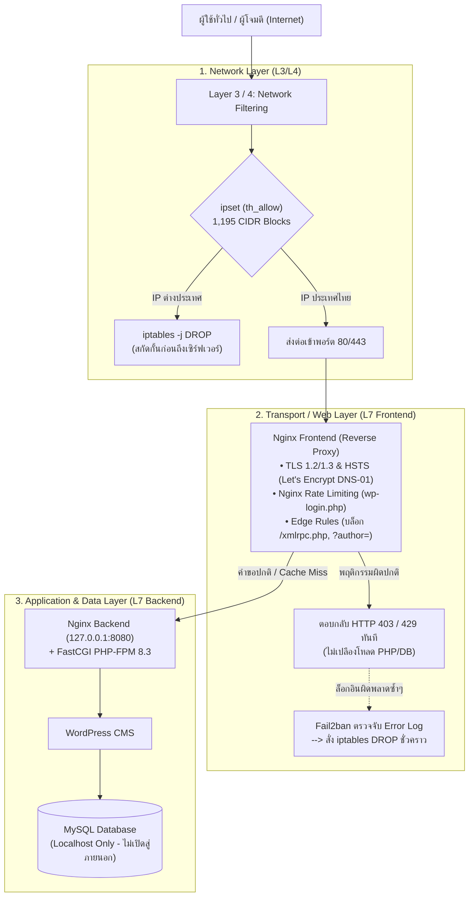

# รายงานการวิเคราะห์และข้อเสนอแนะการปรับปรุงรายงานโครงงาน
**วิชา:** 88633065-65 Computer Networks (เครือข่ายคอมพิวเตอร์)  
**หัวข้อ:** การติดตั้งเว็บเซิร์ฟเวอร์และระบบรักษาความปลอดภัยบนคลาวด์ ด้วย Microsoft Azure, Ubuntu, Nginx และ WordPress  
**ผู้สอน:** ผศ.ภูษิต กุลเกษม | คณะวิทยาการสารสนเทศ มหาวิทยาลัยบูรพา  

---

## สารบัญการวิเคราะห์
1. [จุดผิดพลาดวิกฤตที่ต้องแก้ไขทันทีก่อนส่ง (Critical Fixes)](#1-จุดผิดพลาดวิกฤตที่ต้องแก้ไขทันทีก่อนส่ง-critical-fixes)
2. [สรุปวิธีต่างๆ ข้อดี และเหตุผลเชิงเทคนิค (Why & Advantages Matrix)](#2-สรุปวิธีต่างๆ-ข้อดี-และเหตุผลเชิงเทคนิค-why--advantages-matrix)
3. [รายละเอียดการปรับปรุงแบบเจาะลึกรายบท (Chapter-by-Chapter Guide)](#3-รายละเอียดการปรับปรุงแบบเจาะลึกรายบท-chapter-by-chapter-guide)
   - [หน้าปกและส่วนนำ (หน้า 1–4)](#หน้าปกและส่วนนำ-หน้า-14)
   - [บทที่ 1 บทนำ (หน้า 5–6)](#บทที่-1-บทนำ-หน้า-56)
   - [บทที่ 2 ทฤษฎีและเทคโนโลยีที่เกี่ยวข้อง (หน้า 7–8)](#บทที่-2-ทฤษฎีและเทคโนโลยีที่เกี่ยวข้อง-หน้า-78)
   - [บทที่ 3 วิธีดำเนินงาน (หน้า 9–10)](#บทที่-3-วิธีดำเนินงาน-หน้า-910)
   - [บทที่ 4 ผลการดำเนินงานและการทดสอบ (หน้า 11–13)](#บทที่-4-ผลการดำเนินงานและการทดสอบ-หน้า-1113)
   - [บทที่ 5 สรุปผล ปัญหา และข้อเสนอแนะ (หน้า 14–15)](#บทที่-5-สรุปผล-ปัญหา-และข้อเสนอแนะ-หน้า-1415)
   - [ภาคผนวก ก และ ข (หน้า 16–19)](#ภาคผนวก-ก-และ-ข-หน้า-1619)
4. [ข้อความตัวอย่าง (Text Snippets) ที่สามารถคัดลอกไปวางในเล่มได้ทันที](#4-ข้อความตัวอย่าง-text-snippets-ที่สามารถคัดลอกไปวางในเล่มได้ทันที)

---

## 1. จุดผิดพลาดวิกฤตที่ต้องแก้ไขทันทีก่อนส่ง (Critical Fixes)

> [!CAUTION]
> จุดเหล่านี้เป็นข้อผิดพลาดที่เห็นได้ชัดเจน และอาจส่งผลให้ถูกหักคะแนนได้ทันทีหากไม่ได้รับการแก้ไขก่อนส่งเล่มฉบับสมบูรณ์

| หน้าที่ | ตำแหน่ง | ปัญหาที่พบ | แนวทางแก้ไขที่ถูกต้อง |
| :--- | :--- | :--- | :--- |
| **หน้า 1** | ท้ายหน้าปก | ข้อความพิมพ์ไม่ครบ: `ภาคเรียนที่ 1 ปีการศึกษา 256` (ตกเลขตัวท้าย) | แก้ไขเป็น `ภาคเรียนที่ 1 ปีการศึกษา 2567` (หรือ `2569` ตามบริบทของหลักสูตร) |
| **หน้า 11–12** | ใต้ภาพ 4.1, 4.2, 4.3 | คำบรรยายใต้ภาพซ้ำกันทั้งหมด: *"ภาพที่ 4.x ตัวอย่างหน้าจอ SecDash และผลสถิติการใช้งาน"* | เปลี่ยนคำบรรยายให้ตรงกับภาพเฉพาะส่วน (ดูรายละเอียดในหัวข้อบทที่ 4) |
| **หน้า 16–17** | ใต้ภาพ ก.1, ก.2, ก.3 | คำบรรยายใต้ภาพซ้ำกันทั้งหมด: *"ภาพที่ ก.x หน้าจอส่วนจัดการความปลอดภัยของระบบ"* | เปลี่ยนคำบรรยายให้ตรงกับฟังก์ชันของหน้าจอ (เช่น หน้าจัดการ IP, หน้า Audit Logs, หน้า Modal เพิ่มกฎ) |
| **หน้า 18** | ภาพ ข.2 | ภาพแสดงข้อผิดพลาด `curl: (6) Could not resolve host: nenenainaemak.duckdns.org` ซึ่งแปลว่าเน็ตหลุดหรือพิมพ์ชื่อโฮสต์ผิด ไม่ใช่ผลการบล็อกของ Nginx | ทดสอบรันคำสั่ง `curl -I https://nenenainaemak.duckdns.org/xmlrpc.php` ใหม่ แล้วแคปภาพที่ได้รับคำตอบ `HTTP/1.1 403 Forbidden` จริงมาวางแทน |

---

## 2. สรุปวิธีต่างๆ ข้อดี และเหตุผลเชิงเทคนิค (Why & Advantages Matrix)

ตารางนี้สรุปภาพรวมคำตอบสำหรับคำถาม **"แต่ละวิธีมีข้อดีอย่างไร และทำไมถึงเลือกใช้แบบนี้"** ซึ่งเป็นหัวใจสำคัญของวิชา Computer Networks:

| วิธีการ / เทคโนโลยีที่ใช้ | ข้อดี (Advantages) | ทำไมถึงเลือกใช้แบบนี้? (Why this approach?) |
| :--- | :--- | :--- |
| **1. ipset ร่วมกับ iptables (GeoIP th_allow)** | • สกัดกั้นบอตต่างประเทศ (>90%) ตั้งแต่ Network Layer ก่อนถึงเว็บเซิร์ฟเวอร์ • ประหยัด RAM, CPU และ Bandwidth ของเซิร์ฟเวอร์ | **O(1) vs O(N) Complexity:** การใส่ IP ช่วงไทย 1,195 บล็อกลงใน iptables ตรงๆ จะทำให้เคอร์เนลต้องสแกนทีละบรรทัดแบบ Linear Search (O(N)) จนระบบหน่วง แต่การใช้ `ipset` เป็นโครงสร้าง **Hash Table (O(1))** ทำให้ความเร็วในการตรวจสอบ IP 1,195 ช่วง เร็วเท่ากับการตรวจ IP เพียงตัวเดียว |
| **2. สถาปัตยกรรม Two-Tier Nginx (แยก Frontend ออกจาก Backend)** | • **Security Isolation:** ป้องกันไม่ให้แอปพลิเคชันหลังบ้าน (PHP-FPM, MySQL) สัมผัสกับอินเทอร์เน็ตภายนอกโดยตรง • มี FastCGI Caching ช่วยลดโหลดเซิร์ฟเวอร์ | **Edge Dropping:** Nginx ด้านหน้ารับบทเป็นกันชนคัดกรองคำขอขยะ (เช่น `/xmlrpc.php`, `?author=1`) และตอบกลับ `HTTP 403 Forbidden` ตั้งแต่ชั้นหน้าบ้าน โดยคำขอขยะเหล่านี้ **ไม่เคยวิ่งไปถึง PHP-FPM หรือ MySQL เลย** ทำให้ฐานข้อมูลไม่ล่ม |
| **3. Let's Encrypt ผ่าน DNS-01 Challenge** | • เข้ารหัสการสื่อสารด้วย HTTPS (TLS 1.2/1.3) และเปิดใช้ HSTS • ขอและต่ออายุใบรับรองอัตโนมัติผ่าน DuckDNS | **แก้ข้อจำกัดของ GeoIP Firewall:** เซิร์ฟเวอร์ Let's Encrypt ตั้งอยู่ในต่างประเทศ หากใช้ `HTTP-01 Challenge` ระบบของ Let's Encrypt จะเชื่อมต่อพอร์ต 80 เข้ามาไม่ได้เพราะติดไฟร์วอลล์บล็อกต่างประเทศ การใช้ `DNS-01 Challenge` ตรวจสอบผ่าน DNS TXT Record จึงเป็นวิธีเดียวที่ทำให้ขอ SSL สำเร็จโดยไม่ต้องเปิดพอร์ตให้ทั่วโลก |
| **4. Fail2ban ร่วมกับ Nginx Rate Limiting** | • ป้องกันการโจมตีแบบ Brute Force รหัสผ่าน • ปรับเปลี่ยนสถานะการลงโทษแบบไดนามิก (Stateful Active Defense) | **Stateless vs Stateful:** Nginx Rate Limit ทำได้แค่หน่วงเวลาหรือตอบ 429 แต่ผู้โจมตียังคงส่งแพ็กเก็ตเข้ามาได้เรื่อยๆ การเสริมด้วย Fail2ban จะดักจับผู้ที่ล็อกอินผิดซ้ำๆ แล้วสั่งให้ `iptables` ตัดการเชื่อมต่อที่ระดับเคอร์เนล (DROP) ทำให้บอตหยุดยิงทันที |
| **5. AI SecOps แบบ Read-Only & IP Masking** | • แปลงบันทึก Log หลายหมื่นบรรทัดเป็นบทสรุปเชิงลึกที่เข้าใจง่ายใน 30 วินาที • มีข้อเสนอแนะเชิงป้องกัน (Actionable Recommendations) | **Zero-Trust & Privacy:** มีการ Masking ปิดบังเลขท้าย IP (เช่น `34.182.207.x`) ก่อนส่งไปยังโมเดล LLM เพื่อคุ้มครองความเป็นส่วนตัว และกำหนดให้ AI เป็น **"ที่ปรึกษาแบบอ่านอย่างเดียว"** ห้ามสั่งแก้ไขระบบเครือข่าย เพื่อป้องกันปัญหา AI ทำงานผิดพลาด (Hallucination) |
| **6. SecDash Control API พร้อม Admin Self-Ban Protection** | • ผู้ดูแลระบบสามารถกดปลดแบน (Unban) หรือบล็อก IP เพิ่มเติมได้แบบ Real-time ผ่านเว็บ • มีบันทึกประวัติ (Audit Logs) ถาวร | **Operational Safety:** หากแอดมินเผลอคลิกบล็อก IP ตัวเอง เซิร์ฟเวอร์จะถูกตัดขาดทันที จึงต้องสร้างระบบตรวจสอบ `request.client.host` และ `X-Real-IP` ทั้งในระดับ UI และ API เพื่อปฏิเสธการบล็อก IP ของแอดมิน ป้องกันไม่ให้ระบบล็อกตัวเอง |

---

## 3. รายละเอียดการปรับปรุงแบบเจาะลึกรายบท (Chapter-by-Chapter Guide)

### หน้าปกและส่วนนำ (หน้า 1–4)
* **หน้า 1 (หน้าปก):** เติมตัวเลขปีการศึกษาให้สมบูรณ์ เช่น `ภาคเรียนที่ 1 ปีการศึกษา 2567`
* **หน้า 2 (คำนำ):** ควรเพิ่มข้อความสั้นๆ ระบุว่าโครงงานนี้เป็นการประยุกต์ใช้องค์ความรู้ตามแบบจำลอง **OSI 7 Layers และ TCP/IP Model** ในสถานการณ์จริงบนระบบคลาวด์

---

### บทที่ 1 บทนำ (หน้า 5–6)
* **หัวข้อ 1.1 ที่มาและความสำคัญ (สิ่งที่ควรเสริม):**
  * ขยายความเรื่องแนวคิด **Defense-in-Depth (การป้องกันแบบหลายชั้นเชิงลึก)** อธิบายว่าเหตุใดการมี Firewall เพียงอย่างเดียว หรือการมีเว็บแอปพลิเคชันเพียงอย่างเดียวจึงไม่เพียงพอในการรับมือภัยคุกคามยุคปัจจุบัน
* **หัวข้อ 1.3 ขอบเขตของโครงงาน (สิ่งที่ควรเสริม):**
  * เพิ่มเติมขอบเขตของ **SecDash Control API** ที่สามารถสั่งการแก้ไขกฎ iptables และ fail2ban ได้จริงแบบ 2-way communication ไม่ใช่เพียงการแสดงผลสถิติแบบ Static

---

### บทที่ 2 ทฤษฎีและเทคโนโลยีที่เกี่ยวข้อง (หน้า 7–8)
* **หัวข้อ 2.4 Firewall และการกรอง IP (สิ่งที่ควรเสริมในหน้า 7–8):**
  * **ใส่เหตุผลเรื่อง Time Complexity:** อธิบายความแตกต่างระหว่าง Linear Scan ของ iptables ปกติ กับ Hash-based Lookup ของ `ipset` ที่ช่วยให้การเทียบเคียง 1,195 CIDR blocks มีประสิทธิภาพระดับ $O(1)$
  * **ระบุข้อจำกัดของ GeoIP:** ระบุชัดเจนว่า GeoIP เหมาะสำหรับลดพื้นที่การถูกโจมตี (Attack Surface Reduction) แต่ไม่สามารถป้องกันผู้โจมตีที่ใช้ Proxy หรือ VPN ภายในประเทศไทยได้ จึงจำเป็นต้องมีมาตรการชั้นถัดไป (Defense-in-Depth)
* **หัวข้อ 2.5 เว็บเซิร์ฟเวอร์และ Reverse Proxy (สิ่งที่ควรเสริมในหน้า 8):**
  * เพิ่มคำอธิบายเรื่อง **Two-Tier Architecture**: การแยก Nginx Frontend (Edge) ให้ทำหน้าที่ TLS Termination, Rate Limiting และ Caching เพื่อปกป้อง Nginx Backend และ PHP-FPM ไม่ให้ต้องประมวลผลคำขอที่ไร้ประโยชน์

---

### บทที่ 3 วิธีดำเนินงาน (หน้า 9–10)
* **หัวข้อ 3.1 ภาพรวมสถาปัตยกรรม (สิ่งที่ควรเสริมในหน้า 9):**
  * ในตารางสรุปชั้นระบบ ควรระบุ Protocol และ Port ให้ชัดเจนยิ่งขึ้น เช่น:
    * ภายนอก $\rightarrow$ DNS Port 53, HTTPS Port 443
    * เครือข่าย $\rightarrow$ Linux iptables (Layer 3/4)
    * เว็บด้านหน้า $\rightarrow$ Nginx Reverse Proxy (Layer 7)
    * แอปพลิเคชัน $\rightarrow$ Loopback `127.0.0.1:8080` (FastCGI Unix Socket)
    * ฐานข้อมูล $\rightarrow$ MySQL `127.0.0.1:3306`
* **หัวข้อ 3.4 การตั้งค่าความปลอดภัยเครือข่าย (สิ่งที่ควรเสริมในหน้า 10):**
  * **ข้อ 8 (DNS-01 Challenge):** เพิ่มเหตุผลว่าทำไมถึงเลือก DNS-01 แทน HTTP-01 เพราะระบบติดเงื่อนไข GeoIP Firewall
* **หัวข้อ 3.5 การติดตั้ง Dashboard และ AI (สิ่งที่ควรเสริมในหน้า 10):**
  * เพิ่มหัวข้อย่อย **"การควบคุมไฟร์วอลล์แบบ Real-time ผ่าน API และระบบป้องกัน Admin Self-Ban"**:
    * อธิบายว่า SecDash มี Backend API (FastAPI) ที่เชื่อมต่อกับคำสั่ง `iptables` และ `fail2ban-client`
    * มีการสร้างฟังก์ชันดักจับ IP ผู้ดูแลระบบ เพื่อป้องกันไม่ให้ผู้ดูแลระบบเผลอสั่งบล็อกการเชื่อมต่อของเครื่องตนเอง

---

### บทที่ 4 ผลการดำเนินงานและการทดสอบ (หน้า 11–13)
* **หัวข้อ 4.1 ผลการทำงานของระบบ (การแก้คำบรรยายภาพในหน้า 11–12):**
  * **เปลี่ยนชื่อภาพ 4.1:** *ภาพที่ 4.1 หน้าจอแสดงผลรวมสถิติทราฟฟิก กราฟแนวโน้ม และสถานะการป้องกันของ SecDash*
  * **เปลี่ยนชื่อภาพ 4.2:** *ภาพที่ 4.2 ผลการวิเคราะห์แนวโน้มภัยคุกคามและสรุปสถานการณ์โดย AI (Executive Summary & Key Findings)*
  * **เปลี่ยนชื่อภาพ 4.3:** *ภาพที่ 4.3 ข้อเสนอแนะเชิงป้องกัน (Recommendations) และสถิติคำขอย้อนหลัง 24 ชั่วโมง*
* **หัวข้อ 4.3 ผลการทดสอบ (ตารางในหน้า 13):**
  * เพิ่มแถวการทดสอบ **"การปลดแบนและการบล็อก IP ผ่านหน้าแดชบอร์ด (SecDash Control API)"**:
    * วิธีตรวจสอบ: สั่งปลดแบน/บล็อก IP ผ่านหน้าเว็บ และตรวจเช็กสถานะใน `iptables -L INPUT -v -n` และ `fail2ban-client status`
    * ผลการทดสอบ: คำสั่งลบและเพิ่มกฎใน iptables ทำงานสำเร็จจริงภายในเวลาน้อยกว่า 1 วินาที และมีบันทึกลงใน Audit Logs ถาวร

---

### บทที่ 5 สรุปผล ปัญหา และข้อเสนอแนะ (หน้า 14–15)
* **หัวข้อ 5.2 ปัญหาที่พบและแนวทางแก้ไข (สิ่งที่ควรเพิ่มในตารางหน้า 14):**
  * เพิ่มปัญหา: **"การเผลอบล็อก IP ของตนเองทำให้ถูกตัดขาดจากเซิร์ฟเวอร์"**
  * แนวทางแก้ไข: **"เข้าแก้ไขผ่าน Azure Portal Run Command หรือสลับเครือข่าย และได้พัฒนาระบบ Admin Self-Ban Protection เพื่อตรวจจับและล็อกปุ่มห้ามบล็อก IP ตนเองทั้งฝั่ง Frontend และ API"**

---

### ภาคผนวก ก และ ข (หน้า 16–19)
* **ภาคผนวก ก (ภาพหน้าจอระบบ):**
  * **เปลี่ยนชื่อภาพ ก.1:** *ภาพที่ ก.1 หน้าจอระบบจัดการการปลดแบนและกฎไฟร์วอลล์ IP (Unban & Threat Management)*
  * **เปลี่ยนชื่อภาพ ก.2:** *ภาพที่ ก.2 หน้าจอบันทึกประวัติการแก้ไขกฎไฟร์วอลล์ (Audit Logs) แสดงรายการปลดแบนและบล็อก*
  * **เปลี่ยนชื่อภาพ ก.3:** *ภาพที่ ก.3 หน้าต่างโมดอลสำหรับเพิ่ม IP เข้า Whitelist หรือ DROP บนเซิร์ฟเวอร์*
* **ภาคผนวก ข (หลักฐานการทดสอบ):**
  * **แก้ไขภาพ ข.2:** แคปภาพผลลัพธ์คำสั่งใหม่ที่รันสำเร็จและได้สถานะ `HTTP/1.1 403 Forbidden`

---

## 4. ข้อความตัวอย่าง (Text Snippets) ที่สามารถคัดลอกไปวางในเล่มได้ทันที

### ตัวอย่างข้อความสำหรับเสริมใน บทที่ 2 (หัวข้อ 2.4 - ipset & iptables)
> *"ในการกำหนดกฎไฟร์วอลล์ด้วย iptables ร่วมกับชุดข้อมูลช่วง IP ประเทศไทยจำนวน 1,195 CIDR blocks หากกำหนดกฎเรียงต่อกันใน iptables โดยตรง แพ็กเก็ตที่เข้ามาจะต้องผ่านการเปรียบเทียบทีละกฎตามลำดับ ซึ่งมีค่าความซับซ้อนเชิงเวลาแบบ $O(N)$ ส่งผลให้เกิดความล่าช้า (Latency) ในการสื่อสารและใช้ทรัพยากร CPU สูง โครงงานนี้จึงเลือกประยุกต์ใช้ ipset ซึ่งจัดเก็บข้อมูลในรูปแบบตารางแฮช (Hash Table) ทำให้การสืบค้นและตรวจสอบสถานะของ IP มีค่าความซับซ้อนเชิงเวลาเพียง $O(1)$ แม้จะมีจำนวนรายการเครือข่ายมากกว่าพันช่วงเวลาในการประมวลผลก็ยังคงรวดเร็วในระดับคงที่"*

### ตัวอย่างข้อความสำหรับเสริมใน บทที่ 2 (หัวข้อ 2.3 - DNS-01 Challenge)
> *"สำหรับการออกใบรับรองความปลอดภัย HTTPS ของ Let's Encrypt ตามปกติจะนิยมใช้ HTTP-01 Challenge ซึ่งเซิร์ฟเวอร์ของผู้ให้บริการจะเชื่อมต่อเข้ามายังพอร์ต 80 เพื่อตรวจสอบไฟล์ยืนยัน อย่างไรก็ตาม เนื่องจากโครงงานนี้ได้เปิดใช้งาน GeoIP Firewall สกัดกั้นการเชื่อมต่อจากนอกประเทศไทย ทำให้โหนดตรวจสอบของ Let's Encrypt ในต่างประเทศไม่สามารถเข้าถึงพอร์ต 80 ได้ โครงงานจึงเลือกใช้ DNS-01 Challenge ผ่าน DuckDNS API ซึ่งทำการตรวจสอบสิทธิ์ความเป็นเจ้าของโดเมนผ่านระเบียน DNS TXT แทน ทำให้สามารถขอและต่ออายุใบรับรองความปลอดภัยได้อย่างราบรื่นโดยไม่จำเป็นต้องลดทอนนโยบายการรักษาความปลอดภัยของไฟร์วอลล์"*

### ตัวอย่างข้อความสำหรับเสริมใน บทที่ 3 (หัวข้อ 3.5 - SecDash API & Protection)
> *"นอกจากหน้าที่ในการสรุปผลข้อมูลสถิติแล้ว แดชบอร์ด SecDash ยังได้รับการพัฒนาเพิ่มเติมให้มีระบบควบคุมไฟร์วอลล์แบบสองทาง (Two-Way Firewall Control) ผ่าน SecDash Control API (FastAPI) โดยผู้ดูแลระบบสามารถสั่งปลดแบน (ลบกฎ iptables DROP และสั่ง fail2ban-client unban) หรือสั่งบล็อก IP ต้องสงสัยเพิ่มเติมได้แบบทันที (Real-Time) ทั้งนี้ เพื่อความปลอดภัยสูงสุด ระบบได้บรรจุมาตรการ Admin Self-Ban Protection ทั้งในชั้น UI และ API เพื่อดักจับ IP ปัจจุบันของผู้ดูแลระบบและไม่อนุญาตให้สั่งบล็อก IP ของตนเอง ป้องกันความเสี่ยงจากการถูกตัดการเชื่อมต่อออกจากเซิร์ฟเวอร์"*
